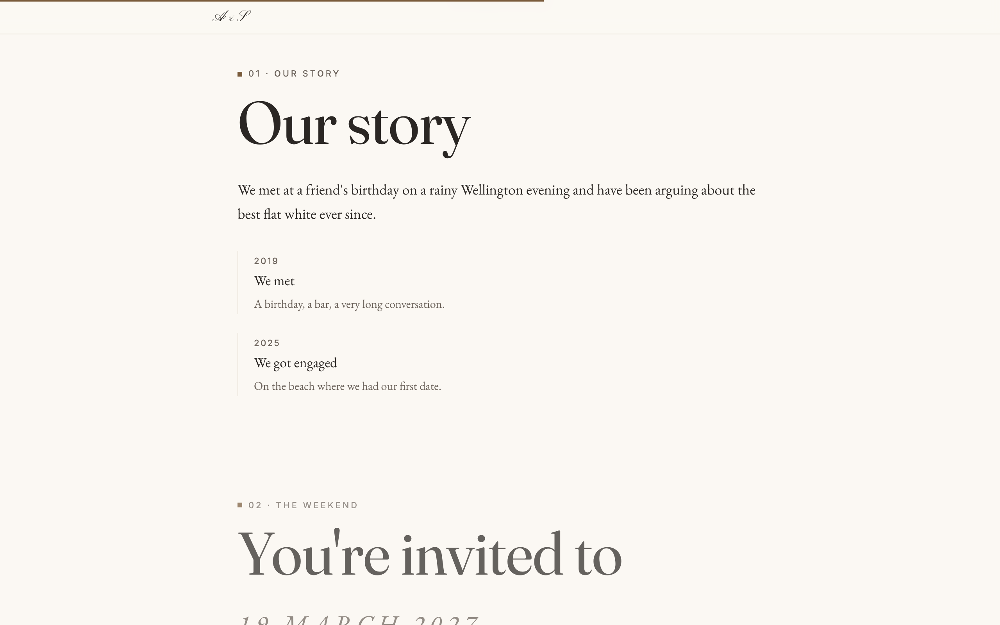
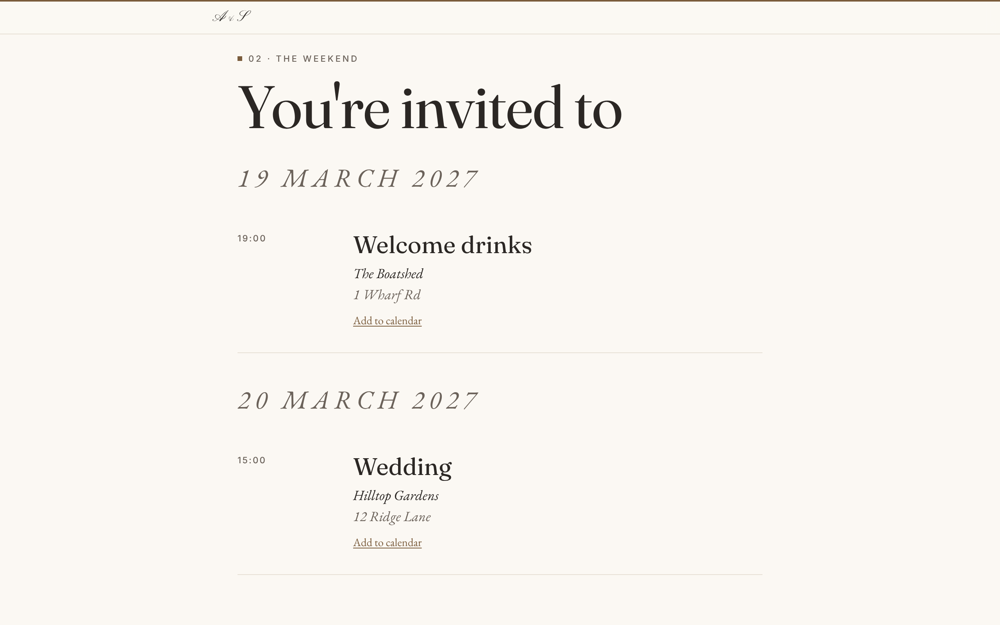

# WEDPLAN

[](https://github.com/Razorlovesrugby/WEDPLAN/actions/workflows/verify.yml)
[](LICENSE)

A wedding planning platform for a couple and their close collaborators to run
the whole wedding from one place, replacing a pile of spreadsheets and group
chats.

**Stack:** Next.js 15 (App Router) · Supabase (Postgres, Auth, RLS) · TypeScript · Tailwind · Vitest · deployed on Vercel

## Screenshots

The public wedding site as a guest sees it, rendered with placeholder data. The site is assembled from blocks in a builder, and each theme and layout is configurable.

<p>
  
  
</p>
<p>
  
  
</p>

## What it covers

- **Guests and households.** Households are the invite unit, guests the
  headcount unit. RSVP, dietary and accessibility needs, custom questions, and
  a ranked, multi-cut guest list for trimming an oversized list to capacity.
- **Invitations and a public wedding site.** A block-based site builder,
  per-household invitation links (no account needed), save-the-dates, RSVP in
  the site's own theme, a gift registry and seating plan.
- **Lists, timeline and reminders.** Lists auto-sync to a timeline; a weekly
  digest only chases people who haven't finished answering.
- **Day-of run sheet** and per-event guest lines.
- **Budget.** Categories, line items, per-head and consumption-based costing,
  a payment schedule. NZD only, with GST.
- **Moodboards.** Shareable boards, Pinterest import, and a Chrome clipper
  (`extension/`).
- **Operations.** Append-only audit log, encrypted backup and restore scripts
  (`docs/RESTORE.md`), CSV and zip export.

Each feature has a proposal-plus-decisions document in [`docs/specs/`](docs/specs/README.md).

## Design decisions worth reading

- **Tenancy is a foreign key, not a convention.** Every table carries
  `wedding_id`; children reference `(parent_id, wedding_id)`, so attaching a
  record in one wedding to a parent in another is a constraint violation, even
  for the service role. RLS on every table, tested with a second account.
- **Money is integer minor units.** No float rounding anywhere.
- **Timestamps are `timestamptz`**, displayed in the wedding's own timezone.
- **No destructive writes to guest data.** `deleted_at`, never a hard delete,
  so a guest cut after invitations went out stays reconstructable.
- **The service-role client is an allowlist**, each caller scoping itself
  (see `src/lib/supabase/admin.ts`). Everything a signed-in user does goes
  through the RLS-enforced client.
- **Migrations are append-only** and verified against a throwaway Postgres
  cluster with no Docker or Supabase CLI.

## Getting started

Requires Node 20.11+ and the [Supabase CLI](https://supabase.com/docs/guides/local-development).

```bash
npm install
cp .env.example .env.local        # every value is explained in the file
supabase start                    # or point at a hosted project
supabase db reset                 # applies migrations and the dev seed
node scripts/ensure-bucket.mjs    # private moodboards storage bucket (once per environment)
npm run dev
```

## Checks

```bash
npm run typecheck                 # strict, with noUncheckedIndexedAccess
npm test                          # Vitest unit tests
./scripts/verify-migrations.sh    # SQL assertions on a throwaway cluster (not as root)
npm run build
```

CI (`.github/workflows/verify.yml`) runs all of these on every push.

## Layout

```
src/
  app/            routes: planner screens, public RSVP, public site, API
  components/
  lib/            pure, unit-tested logic
  server/
    actions/      every write (server actions returning ActionResult)
    queries/      every read (wrapped in cache())
supabase/
  migrations/     schema, RLS, views
  tests/          tenancy and derived-value SQL assertions
  seed.sql        two weddings, because a tenancy test with one tenant proves nothing
extension/        Chrome MV3 clipper, not part of the Next.js build
docs/             spec, per-feature specs, HANDOFF.md (current state)
```

## Status

A personal project, built in public. It is live and in use by real couples
and their guests. Feature specs 1–47 are built. Automated verification is
typecheck, unit tests, the SQL suite and production builds, plus
headless-browser checks of some screens. [`docs/HANDOFF.md`](docs/HANDOFF.md)
has the current state.

## Licence

[MIT](LICENSE)
